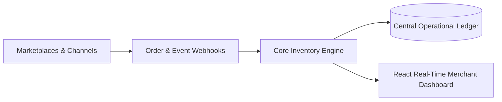

# E-Commerce Multi-Channel Operations Engine

> Full-stack inventory and order tracking synchronization system for digital storefronts.

[](https://github.com/sohailahmed-bsrh/ecomerce-automation)
[](https://sohail.devsil.com/projects.html)
[](https://sohail.devsil.com)

---

## Overview

Managing orders, returns, and inventory across fragmented marketplaces leads to stockouts, delayed fulfillment, and dissatisfied buyers.

This project provides an end-to-end, reproducible implementation engineered to solve this challenge through verified data transformations, robust algorithms, and production-ready architecture.

---

## Key Features

- Unified inventory ledger maintaining consistent stock levels across sales channels
- Automated order intake and fulfillment status webhooks
- Express backend API service coupled with a React/Tailwind analytics frontend
- Modular architecture configured for production containerization

---

## System Architecture



---

## Technology Stack

| Technology | Version / Spec | Role in Architecture |
| :--- | :--- | :--- |
| **Node.js & Express** | `18+` | Microservice routing, event handlers, and data sync |
| **React & Vite** | `18.2+` | Merchant analytics portal and order review table |
| **PostgreSQL / SQLite** | `Latest` | Relational transaction records |

---

## Repository Structure

```text
ecomerce-automation/
|-- backend/
|   |-- src/
|   `-- package.json
|-- frontend/
|   |-- src/
|   `-- package.json
|-- .gitignore
`-- README.md
```

---

## Installation and Execution

### Prerequisites
- Python 3.10 or higher
- Git version control
- Virtual environment manager (`venv`)

### Setup Instructions
1. Clone the repository:
```bash
git clone https://github.com/sohailahmed-bsrh/ecomerce-automation.git
cd ecomerce-automation
```

2. Configure environment and dependencies:
```bash
cd backend && npm install
cd ../frontend && npm install
npm run dev
```

---

## Interface and Verification
The system produces verifiable execution logs, prediction matrices, or interactive browser interfaces depending on the target mode. Verify operation by executing the commands specified above or inspecting the demonstration notebooks.

---

## Author and Contact
Developed by **Sohail Ahmed** — Full Stack AI Engineer & Machine Learning Specialist.
- **Portfolio:** [sohail.devsil.com](https://sohail.devsil.com)
- **GitHub:** [@sohailahmed-bsrh](https://github.com/sohailahmed-bsrh)
- **Email:** [sohail.bsrh@gmail.com](mailto:sohail.bsrh@gmail.com)
