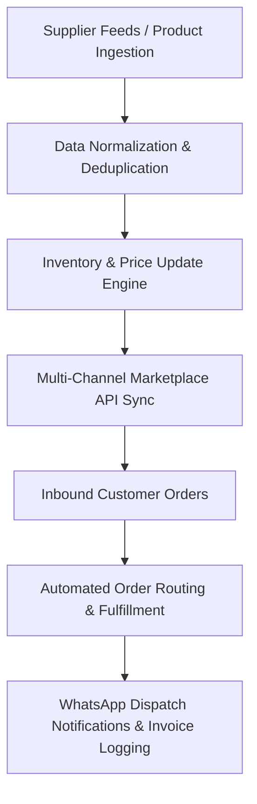

<div align="center">

<h1>E-Commerce Workflow Automation Engine</h1>


<p><strong>Automated Inventory Ingestion, Order Synchronization, and Price Management Platform</strong></p>

<p>
  <a href="https://skillicons.dev"></a>
</p>

<p>
  <a href="#overview">Overview</a> &bull;
  <a href="#purpose--problem-statement">Purpose</a> &bull;
  <a href="#real-world-industry-applications">Use Cases</a> &bull;
  <a href="#step-by-step-engineering-walkthrough">How It Was Built</a> &bull;
  <a href="#system-architecture">Architecture</a> &bull;
  <a href="#visual-showcase-gallery">Visual Gallery</a> &bull;
  <a href="#technology-stack-matrix">Tech Stack</a> &bull;
  <a href="#installation--setup">Installation</a> &bull;
  <a href="#author--contact-information">Author</a>
</p>

</div>

---
## Overview

E-Commerce Automation is an enterprise workflow platform that coordinates product catalog management, order fulfillment, supplier price updates, and customer notification workflows across multiple online sales channels.

---

## Purpose & Problem Statement

### The Problem
Growing e-commerce operations often run on fragmented tools: inventory is updated manually, order tracking is sent by hand, and pricing changes across multiple marketplaces lag behind supplier cost fluctuations. These operational bottlenecks lead to stockouts, delayed fulfillment, and lost profit margins.

### The Engineering Purpose
To build a centralized, event-driven e-commerce automation hub that synchronizes supplier inventory feeds, manages order dispatch states, updates dynamic pricing rules, and triggers automated WhatsApp customer notifications upon fulfillment.

---

## Real-World Industry Applications

- **Multi-Channel Retail Operations**: Unifying order and inventory tracking across Shopify, WooCommerce, and custom web stores.
- **Automated Drop-Ship Logistics**: Routing customer orders to suppliers and returning tracking numbers automatically.
- **Dynamic Pricing Platforms**: Continuously adjusting retail prices based on currency fluctuations and supplier wholesale updates.
- **Customer Care & Notification Automation**: Automated dispatch updates via WhatsApp Business API reducing inbound customer support tickets.

---

## Step-by-Step Engineering Walkthrough (How It Was Built)

### Step 1: Centralized Relational Schema & Migration Pipeline
The database layer (`backend/db.js`, `backend/migrations/`) implements relational schemas for products, variants, customer profiles, order fulfillment states, and communication logs.

### Step 2: Multi-Channel Order Ingestion Engine
The order module (`backend/modules/api/orders.js`) provides webhook endpoints that ingest customer orders from sales channels in real time. Orders are validated, assigned sequential internal tracking IDs, and staged for fulfillment.

### Step 3: Automated Supplier Catalog & Inventory Sync
The product module (`backend/modules/api/products.js`) polls supplier feeds. If supplier inventory changes, local stock levels and marketplace listings are updated within seconds to eliminate out-of-stock purchases.

### Step 4: WhatsApp Notification Agent
An automated messaging worker (`backend/modules/whatsapp/agent.js`) listens for order state transitions (Confirmed, Packed, In-Transit, Delivered). Upon status changes, it formats personalized customer messages and delivers them via WhatsApp.

### Step 5: Enterprise Analytics & Management Dashboard
The React frontend (`frontend/`) visualizes order velocities, regional fulfillment statistics, revenue margins, and webhook latency metrics in real time.

---

## System Architecture



---

## Visual Showcase Gallery

<table width="100%" align="center">
  <tr>
    <td width="50%" align="center"><b>Platform Overview & Key Metrics</b><br><sub>Real-time overview of active store orders, catalog count, and sync state.</sub></td>
    <td width="50%" align="center"><b>Product Ingestion & Mapping</b><br><sub>Supplier catalog synchronization and variant mapping.</sub></td>
  </tr>
  <tr>
    <td align="center"></td>
    <td align="center"></td>
  </tr>
  <tr>
    <td width="50%" align="center"><b>Order Fulfillment Pipeline</b><br><sub>Multi-stage order tracking from checkout to shipment dispatch.</sub></td>
    <td width="50%" align="center"><b>Inventory Stock Level Monitor</b><br><sub>Automated low-stock alerts and safety stock triggers.</sub></td>
  </tr>
  <tr>
    <td align="center"></td>
    <td align="center"></td>
  </tr>
  <tr>
    <td width="50%" align="center"><b>Dynamic Price Adjustment Engine</b><br><sub>Algorithmic pricing rules factoring supplier costs and margins.</sub></td>
    <td width="50%" align="center"><b>Multi-Channel Storefront Connector</b><br><sub>API configurations for WooCommerce, Shopify, and Amazon.</sub></td>
  </tr>
  <tr>
    <td align="center"></td>
    <td align="center"></td>
  </tr>
  <tr>
    <td width="50%" align="center"><b>Order Processing Status Table</b><br><sub>Granular dispatch status tracking across customer shipments.</sub></td>
    <td width="50%" align="center"><b>Supplier Invoicing & Reconciliation</b><br><sub>Automated matching of supplier purchase orders and receipts.</sub></td>
  </tr>
  <tr>
    <td align="center"></td>
    <td align="center"></td>
  </tr>
  <tr>
    <td width="50%" align="center"><b>Customer Notification Dispatcher</b><br><sub>Automated SMS and email tracking updates for dispatched orders.</sub></td>
    <td width="50%" align="center"><b>Webhook & API Traffic Logs</b><br><sub>System monitor tracking incoming webhooks and dispatch throughput.</sub></td>
  </tr>
  <tr>
    <td align="center"></td>
    <td align="center"></td>
  </tr>
  <tr>
    <td width="50%" align="center"><b>Revenue & Commission Analytics</b><br><sub>Financial summary breakdown by product category and channel.</sub></td>
    <td width="50%" align="center"><b>System Settings & Credentials</b><br><sub>Secure management of external marketplace API keys.</sub></td>
  </tr>
  <tr>
    <td align="center"></td>
    <td align="center"></td>
  </tr>
</table>

---

## Technology Stack Matrix

| Domain | Technologies | Version / Role | Engineering Purpose |
| :--- | :--- | :--- | :--- |
| Backend Server | Node.js, Express | 20.x / 4.19+ | REST API gateway, order state machine, and sync scheduler |
| Messaging Gateway | WhatsApp Business API Integration | Cloud API | Programmatic delivery of dispatch notifications and tracking links |
| Frontend UI | React, Vite, Tailwind CSS | 18.2 / 5.0+ | Real-time merchant control console and order management |
| Relational Storage | SQLite / PostgreSQL | Latest | Persistent catalog index and fulfillment audit logs |

---

## Installation & Setup

```bash
# Clone the repository
git clone https://github.com/sohailahmed-bsrh/ecomerce-automation.git
cd ecomerce-automation

# Install dependencies and start
npm install
npm run dev
```
---

## Author & Contact Information

<table width="100%">
  <tr>
    <td width="150" align="center" valign="middle">
      
    </td>
    <td>
      <h3>Sohail Ahmed</h3>
      <p><strong>Senior Software Engineer & AI Systems Architect</strong></p>
      <p>Specializing in Full-Stack AI Application Development, Computer Vision, Deep Learning Pipelines, and Scalable Automation Architectures.</p>
      <p>
        <a href="https://sohail.devsil.com"><strong>Portfolio Website</strong></a> | 
        <a href="https://github.com/sohailahmed-bsrh"><strong>GitHub Profile</strong></a> | 
        <a href="https://www.linkedin.com/in/sohail-ahmed-devsil/"><strong>LinkedIn</strong></a> | 
        <a href="https://www.kaggle.com/sohail2411126"><strong>Kaggle</strong></a> | 
        <a href="https://x.com/ahmed241126"><strong>Twitter/X</strong></a> | 
        <a href="mailto:se906403@gmail.com"><strong>Email Contact</strong></a>
      </p>
    </td>
  </tr>
</table>
