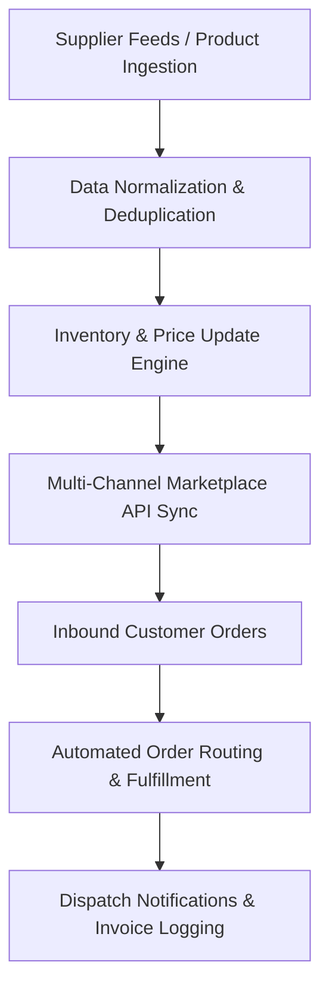

<div align="center">

<h1>E-Commerce Workflow Automation Engine</h1>


<p><strong>Automated Inventory Ingestion, Order Synchronization, and Price Management Platform</strong></p>

<p>
  <a href="https://skillicons.dev"></a>
</p>

<p>
  <a href="#overview">Overview</a> &bull;
  <a href="#system-architecture">Architecture</a> &bull;
  <a href="#visual-showcase-gallery">Visual Gallery</a> &bull;
  <a href="#core-capabilities">Capabilities</a> &bull;
  <a href="#installation--setup">Installation</a> &bull;
  <a href="#author--contact-information">Author</a>
</p>

</div>

---
## Overview

E-Commerce Automation is an enterprise workflow platform that coordinates product catalog management, order fulfillment, supplier price updates, and customer notification workflows across multiple online sales channels.

---

## Visual Showcase Gallery

<table width="100%" align="center">
  <tr>
    <td width="50%" align="center"><b>Platform Overview & Key Metrics</b><br><sub>Real-time overview of active store orders, catalog count, and sync state.</sub></td>
    <td width="50%" align="center"><b>Product Ingestion & Mapping</b><br><sub>Supplier catalog synchronization and variant mapping.</sub></td>
  </tr>
  <tr>
    <td align="center"></td>
    <td align="center"></td>
  </tr>
  <tr>
    <td width="50%" align="center"><b>Order Fulfillment Pipeline</b><br><sub>Multi-stage order tracking from checkout to shipment dispatch.</sub></td>
    <td width="50%" align="center"><b>Inventory Stock Level Monitor</b><br><sub>Automated low-stock alerts and safety stock triggers.</sub></td>
  </tr>
  <tr>
    <td align="center"></td>
    <td align="center"></td>
  </tr>
  <tr>
    <td width="50%" align="center"><b>Dynamic Price Adjustment Engine</b><br><sub>Algorithmic pricing rules factoring supplier costs and margins.</sub></td>
    <td width="50%" align="center"><b>Multi-Channel Storefront Connector</b><br><sub>API configurations for WooCommerce, Shopify, and Amazon.</sub></td>
  </tr>
  <tr>
    <td align="center"></td>
    <td align="center"></td>
  </tr>
  <tr>
    <td width="50%" align="center"><b>Order Processing Status Table</b><br><sub>Granular dispatch status tracking across customer shipments.</sub></td>
    <td width="50%" align="center"><b>Supplier Invoicing & Reconciliation</b><br><sub>Automated matching of supplier purchase orders and receipts.</sub></td>
  </tr>
  <tr>
    <td align="center"></td>
    <td align="center"></td>
  </tr>
  <tr>
    <td width="50%" align="center"><b>Customer Notification Dispatcher</b><br><sub>Automated SMS and email tracking updates for dispatched orders.</sub></td>
    <td width="50%" align="center"><b>Webhook & API Traffic Logs</b><br><sub>System monitor tracking incoming webhooks and dispatch throughput.</sub></td>
  </tr>
  <tr>
    <td align="center"></td>
    <td align="center"></td>
  </tr>
  <tr>
    <td width="50%" align="center"><b>Revenue & Commission Analytics</b><br><sub>Financial summary breakdown by product category and channel.</sub></td>
    <td width="50%" align="center"><b>System Settings & Credentials</b><br><sub>Secure management of external marketplace API keys.</sub></td>
  </tr>
  <tr>
    <td align="center"></td>
    <td align="center"></td>
  </tr>
</table>

---

## System Architecture



---

## Technology Stack

| Domain | Technologies |
| :--- | :--- |
| Frontend | React, Vite, Tailwind CSS, Lucide Icons |
| Backend API | Node.js, Express, TypeScript |
| Database | PostgreSQL / MySQL |

---

## Installation & Setup

```bash
# Clone the repository
git clone https://github.com/sohailahmed-bsrh/ecomerce-automation.git
cd ecomerce-automation

# Install dependencies and start
npm install
npm run dev
```
---

## Author & Contact Information

<table width="100%" align="center">
  <tr>
    <td align="center" style="padding: 20px;">
      <h3>Sohail Ahmed</h3>
      <p><strong>Full-Stack Artificial Intelligence & Computer Vision Engineer</strong></p>
      <p>
        <a href="https://sohail.devsil.com"></a>
        <a href="https://github.com/sohailahmed-bsrh"></a>
        <a href="https://linkedin.com/in/sohail-ahmed-dev"></a>
        <a href="mailto:sohail.bsrh@gmail.com"></a>
      </p>
      <p><em>Available for technical roles in Artificial Intelligence, Computer Vision, and Full-Stack Engineering.</em></p>
      <hr style="border: 0; height: 1px; background: #30363d; margin: 15px 0;">
      <small>Repository: <code>sohailahmed-bsrh/ecomerce-automation</code> &bull; Distributed under the MIT License.</small>
    </td>
  </tr>
</table>
